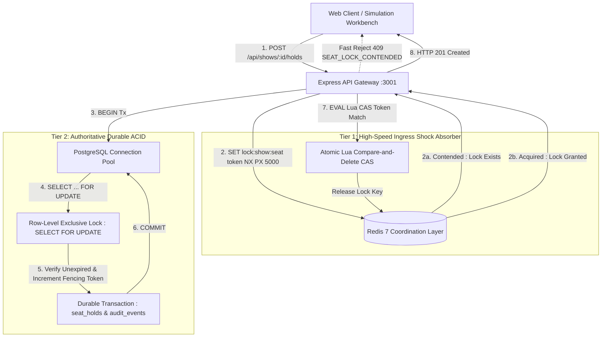

# SeatLock Lab: System Architecture & Coordination Design

**Project:** System Architecture Decoded — Executable Engineering Monograph  
**Module:** SeatLock Lab Concurrency Workbench  
**Status:** Implemented & Verified Reference Architecture  
**Authoritative Date:** October 2026  

---

## 1. Architectural Mission & Core Invariant

SeatLock Lab is an executable reference implementation engineered to demonstrate how planetary-scale ticketing platforms guarantee inventory correctness under extreme contention (flash sales).

### The Invariant
> **"For a given show, a seat cannot have two valid concurrent holds, and a confirmed seat cannot be reserved again."**

To maintain this invariant while serving high-throughput traffic, the system implements a **Two-Tier Hybrid Coordination Architecture**:



---

## 2. Component Taxonomy & Responsibilities

| Tier / Component | Technology | Primary Responsibility | Concurrency Guarantee |
| :--- | :--- | :--- | :--- |
| **API Gateway** | Node.js + Express + TypeScript | Input validation (UUIDs, idempotency keys), trace telemetry orchestration, error mapping. | Non-blocking event loop; requestId attribution. |
| **Ingress Coordination** | Redis 7 + `node-redis` | Short-lived mutual exclusion (`SET NX PX 5000`), connection pool protection during high-traffic spikes. | Sub-millisecond fast-rejection of concurrent contenders. |
| **Safe Lock Release** | Redis Lua Engine | Compares caller worker token before deletion (`GET == ARGV[1] then DEL`). | Prevents releasing expired locks owned by subsequent workers. |
| **Authoritative ACID** | PostgreSQL 16 | Serialized seat verification via `SELECT ... FOR UPDATE`, monotonic fencing token generation, audit event persistence. | **Authoritative Invariant Guardian**; zero double-booking across failures. |
| **Frontend Workbench** | React 18 + Vite + TypeScript | Interactive venue seatmap (40 seats), dual-customer race runner, real-time execution trace viewer, state machine explorer. | Renders live backend traces with zero fabricated stages. |

---

## 3. Request Execution Flow

### 3.1 Normal Winning Reservation Flow
1. **Client Dispatches Request:** Client submits `POST /api/shows/:showId/holds` with headers `Idempotency-Key` and `X-Request-Id`.
2. **Durable Idempotency Check:** Database checks `seat_holds` table for existing `idempotency_key`. If found with matching parameters, returns `200 OK` (`isIdempotentReplay: true`).
3. **Redis Ingress Lock:** API attempts atomic Redis acquisition:
   ```bash
   SET lock:show:<showId>:seat:<seatId> <workerToken> NX PX 5000
   ```
4. **PostgreSQL Transaction:**
   ```sql
   BEGIN;
   SELECT ss.id, ss.status, ss.current_hold_id, ss.fencing_token, ss.hold_expires_at,
          (NOW() > ss.hold_expires_at) AS is_expired
   FROM show_seats ss
   WHERE ss.show_id = $1 AND ss.seat_id = $2
   FOR UPDATE;
   ```
5. **Invariant Verification:**
   - If `status == 'CONFIRMED'`: Rollback transaction, release Redis lock, return `409 SEAT_ALREADY_CONFIRMED`.
   - If `status == 'HELD'` and not expired: Rollback transaction, release Redis lock, return `409 SEAT_ALREADY_HELD`.
   - If `status == 'HELD'` and expired: Mark previous hold `EXPIRED` in `seat_holds`.
6. **Lease Grant & State Mutation:**
   - Compute `nextFencingToken = currentFencingToken + 1`.
   - Insert new `ACTIVE` record into `seat_holds` with 60-second TTL.
   - Update `show_seats` to `HELD`, updating `current_hold_id`, `fencing_token`, and `hold_expires_at`.
   - Insert audit log into `hold_audit_events`.
   - `COMMIT;`
7. **Safe Lock Release:** Release Redis lock using Lua atomic script.
8. **Telemetry Return:** Deliver `201 Created` with full execution trace.

---

## 4. Architecture Decision Records (ADRs)

### ADR-01: Why PostgreSQL Remains Authoritative for Seat Correctness
- **Context:** In-memory stores like Redis provide sub-millisecond latencies, prompting designs where Redis acts as the primary inventory store.
- **Decision:** PostgreSQL remains the sole, authoritative source of truth for seat reservation invariants via `FOR UPDATE` row-level isolation and monotonic fencing tokens. Redis acts strictly as an ingress shock absorber.
- **Rationale:**
  1. **Asynchronous Replication Risk:** Redis replicas replicate asynchronously. A master crash during failover can drop keys, leading to duplicate lock grants.
  2. **Process Stalls & GC Pauses:** A worker stalled by garbage collection or network jitter can exceed its Redis lock TTL. The lock expires, another worker acquires it, and the stalled worker wakes up and writes without knowing its lease expired.
  3. **ACID Durability:** Relational write-ahead logging (WAL) and strict transactions guarantee linearizable invariant validation.
- **Consequences:** Under extreme flash-sale load, PostgreSQL connection pool size is the primary bottleneck. Tier 1 Redis ingress protection is mandatory to absorb excess contenders.

---

### ADR-02: What Redis Coordination Contributes and What It Cannot Guarantee
- **Context:** Deciding the exact contract and reliability expectations placed on the Redis caching/locking layer.
- **Decision:** Redis is deployed as a best-effort mutual-exclusion filter. The application must operate safely and correctly even if Redis is unreachable or bypassed.
- **What Redis Contributes:**
  - Fast-rejects 99.9% of competing requests in &lt;1ms during flash sales.
  - Spares the PostgreSQL connection pool from thousands of queued `FOR UPDATE` transactions.
- **What Redis CANNOT Guarantee:**
  - Absolute mutual exclusion across partition boundaries (split-brain).
  - Survival of locks during master hardware failure without loss.
  - Fencing guarantees against delayed/stale writes.
- **Fallback Policy:** If Redis ping fails, `RedisLockService` logs a warning and returns `coordinationMode: 'POSTGRES_FALLBACK'`. All incoming requests proceed directly to PostgreSQL row locks.

---

### ADR-03: Implementation of Idempotency and Hold Expiration
- **Context:** Network unreliability causes client retries; customer abandonment causes held seats to languish indefinitely without payment.
- **Decision:**
  - **Idempotency:** Implemented durably in PostgreSQL via a unique constraint on `seat_holds.idempotency_key`. A duplicate request replays the existing hold with `200 OK` rather than generating a new hold or incrementing fencing tokens.
  - **Hold Expiration:** Implemented via dual-phase expiration:
    1. *Active DB Time Comparison:* Every `FOR UPDATE` query evaluates `NOW() > ss.hold_expires_at`. If expired, the lease is reclaimed in-flight by the next customer without requiring background cron locks.
    2. *Monotonic Fencing Tokens:* Each hold grant increments `show_seats.fencing_token`. Any subsequent confirmation attempt with a stale fencing token is rejected with `409 FENCING_TOKEN_MISMATCH`.
