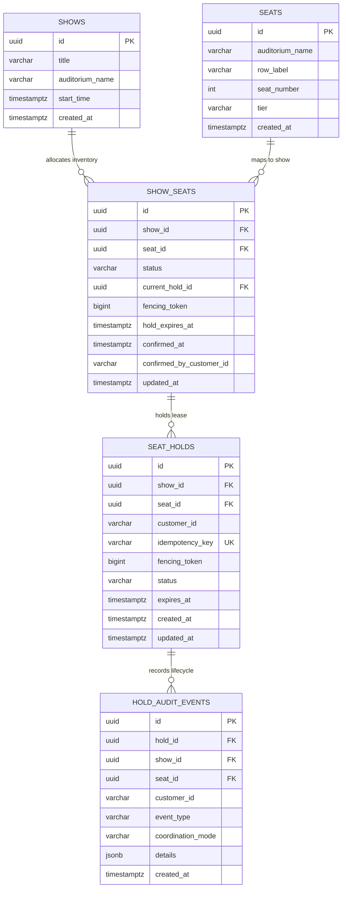

# SeatLock Lab: Database Schema & Consistency Model

**Project:** System Architecture Decoded — Executable Engineering Monograph  
**Module:** PostgreSQL Durable Schema & Isolation Specification  
**Engine:** PostgreSQL 16+  

---

## 1. Schema Diagram (ER Model)



---

## 2. Table Specifications & Data Dictionary

### 2.1 `shows`
Stores event and screening master records.

| Column | Type | Constraints | Description |
| :--- | :--- | :--- | :--- |
| `id` | `UUID` | `PRIMARY KEY` | Unique screening identifier. Deterministic demo ID: `00000000-0000-0000-0000-000000000001`. |
| `title` | `VARCHAR(255)` | `NOT NULL` | Event title (e.g., *Oppenheimer: 70mm IMAX Screening*). |
| `auditorium_name` | `VARCHAR(100)` | `NOT NULL` | Venue hall name (e.g., *IMAX Laser Hall 1*). |
| `start_time` | `TIMESTAMPTZ` | `NOT NULL` | Scheduled screening start timestamp. |
| `created_at` | `TIMESTAMPTZ` | `DEFAULT NOW()` | Record creation timestamp. |

---

### 2.2 `seats`
Static physical seat topology of auditoriums.

| Column | Type | Constraints | Description |
| :--- | :--- | :--- | :--- |
| `id` | `UUID` | `PRIMARY KEY DEFAULT gen_random_uuid()` | Unique physical seat identifier. |
| `auditorium_name` | `VARCHAR(100)` | `NOT NULL` | Auditorium containing the seat. |
| `row_label` | `VARCHAR(10)` | `NOT NULL` | Row designation (`A`, `B`, `C`, `D`). |
| `seat_number` | `INT` | `NOT NULL` | Seat number within row (`1` through `10`). |
| `tier` | `VARCHAR(50)` | `CHECK (tier IN ('VIP', 'PREMIUM', 'STANDARD'))` | Pricing and seating tier category. |
| `created_at` | `TIMESTAMPTZ` | `DEFAULT NOW()` | Record creation timestamp. |

- **Unique Constraint:** `(auditorium_name, row_label, seat_number)` guarantees no duplicate physical seat coordinates exist.

---

### 2.3 `show_seats`
The authoritative inventory state mapping each seat to a specific screening.

| Column | Type | Constraints | Description |
| :--- | :--- | :--- | :--- |
| `id` | `UUID` | `PRIMARY KEY DEFAULT gen_random_uuid()` | Inventory record identifier. |
| `show_id` | `UUID` | `REFERENCES shows(id) ON DELETE CASCADE` | Target show ID. |
| `seat_id` | `UUID` | `REFERENCES seats(id) ON DELETE CASCADE` | Target physical seat ID. |
| `status` | `VARCHAR(20)` | `CHECK (status IN ('AVAILABLE', 'HELD', 'CONFIRMED'))` | Authoritative inventory lifecycle status. |
| `current_hold_id` | `UUID` | `NULLABLE` | Foreign pointer to active `seat_holds.id`. Cleared on expiry/confirmation. |
| `fencing_token` | `BIGINT` | `DEFAULT 1 NOT NULL` | Monotonically incrementing lease token. |
| `hold_expires_at` | `TIMESTAMPTZ` | `NULLABLE` | Expiry cutoff for active holds. Evaluated against `NOW()`. |
| `confirmed_at` | `TIMESTAMPTZ` | `NULLABLE` | Timestamp when booking was permanently purchased. |
| `confirmed_by_customer_id`| `VARCHAR(100)` | `NULLABLE` | Customer ID of final verified purchaser. |
| `updated_at` | `TIMESTAMPTZ` | `DEFAULT NOW()` | Mutation timestamp. |

- **Unique Index:** `idx_show_seats_unique (show_id, seat_id)`.
- **Filtered Index:** `idx_show_seats_available (show_id, status)` optimizes seatmap fetch queries.

---

### 2.4 `seat_holds`
Durable ephemeral reservation leases.

| Column | Type | Constraints | Description |
| :--- | :--- | :--- | :--- |
| `id` | `UUID` | `PRIMARY KEY DEFAULT gen_random_uuid()` | Unique hold lease ID. |
| `show_id` | `UUID` | `REFERENCES shows(id)` | Target show ID. |
| `seat_id` | `UUID` | `REFERENCES seats(id)` | Target seat ID. |
| `customer_id` | `VARCHAR(100)` | `NOT NULL` | Demo simulator customer ID (e.g., `demo-customer-alpha`). |
| `idempotency_key` | `VARCHAR(255)` | `NOT NULL UNIQUE` | Client-supplied idempotency key. |
| `fencing_token` | `BIGINT` | `NOT NULL` | Fencing token assigned at hold grant time. |
| `status` | `VARCHAR(20)` | `CHECK (status IN ('ACTIVE', 'EXPIRED', 'RELEASED', 'CONFIRMED'))` | Hold lease state. |
| `expires_at` | `TIMESTAMPTZ` | `NOT NULL` | Timestamp when lease expires. |
| `created_at` | `TIMESTAMPTZ` | `DEFAULT NOW()` | Creation timestamp. |
| `updated_at` | `TIMESTAMPTZ` | `DEFAULT NOW()` | Last modification timestamp. |

- **Unique Index:** `idx_seat_holds_idempotency UNIQUE (idempotency_key)` guarantees duplicate requests can never generate duplicate hold records.

---

### 2.5 `hold_audit_events`
Immutable write-only audit trail capturing every coordination event.

| Column | Type | Constraints | Description |
| :--- | :--- | :--- | :--- |
| `id` | `UUID` | `PRIMARY KEY DEFAULT gen_random_uuid()` | Audit event ID. |
| `hold_id` | `UUID` | `NULLABLE` | Related hold ID. |
| `show_id` | `UUID` | `NOT NULL` | Related show ID. |
| `seat_id` | `UUID` | `NOT NULL` | Related seat ID. |
| `customer_id` | `VARCHAR(100)` | `NULLABLE` | Customer ID initiating action. |
| `event_type` | `VARCHAR(50)` | `NOT NULL` | Event code (`HOLD_ACQUIRED`, `HOLD_EXPIRED`, `HOLD_RELEASED`, `HOLD_CONFIRMED`). |
| `coordination_mode` | `VARCHAR(50)` | `NOT NULL` | Coordination mode active (`REDIS_PROTECTED` or `POSTGRES_DURABLE`). |
| `details` | `JSONB` | `DEFAULT '{}'` | Structured context (fencing tokens, lock durations, error codes). |
| `created_at` | `TIMESTAMPTZ` | `DEFAULT NOW()` | Immutable log timestamp. |

---

## 3. Transaction Isolation & Locking Semantics

### Row-Level Locking via `SELECT ... FOR UPDATE`
All inventory mutations execute inside strict database transactions using `SELECT ... FOR UPDATE` on `show_seats`.

```sql
SELECT ss.id, ss.show_id, ss.seat_id, ss.status, ss.current_hold_id,
       ss.fencing_token, ss.hold_expires_at,
       (NOW() > ss.hold_expires_at) AS is_expired
FROM show_seats ss
WHERE ss.show_id = $1 AND ss.seat_id = $2
FOR UPDATE;
```

#### Why Row Locks Prevent Double-Booking:
1. When Worker 1 and Worker 2 simultaneously execute `FOR UPDATE` on Seat B-5, PostgreSQL orders the locks.
2. Worker 1 acquires the lock; Worker 2 blocks transparently until Worker 1 commits or rolls back.
3. Worker 1 verifies the seat is `AVAILABLE`, updates it to `HELD`, and calls `COMMIT`.
4. Worker 2 unblocks, re-evaluates the row, sees status `HELD` (unexpired), rolls back, and raises `409 SEAT_ALREADY_HELD`.
5. At no point can two active transactions concurrently observe the row as `AVAILABLE`.

---

## 4. Fencing Token Mechanics

To defeat the Martin Kleppmann split-brain/zombie-worker anomaly:
1. Every time a seat is held, `fencing_token` is incremented: `next_token = current_token + 1`.
2. The generated token is stored both in `show_seats.fencing_token` and in `seat_holds.fencing_token`.
3. When a confirmation request arrives:
   ```sql
   IF seat.current_hold_id != holdId OR seat.fencing_token != hold.fencing_token THEN
       RAISE EXCEPTION 'FENCING_TOKEN_MISMATCH';
   END IF;
   ```
4. If a slow/zombie client woke up after its hold expired and was reassigned to a new customer (with token 3), the slow client (holding token 2) is blocked from confirming.
