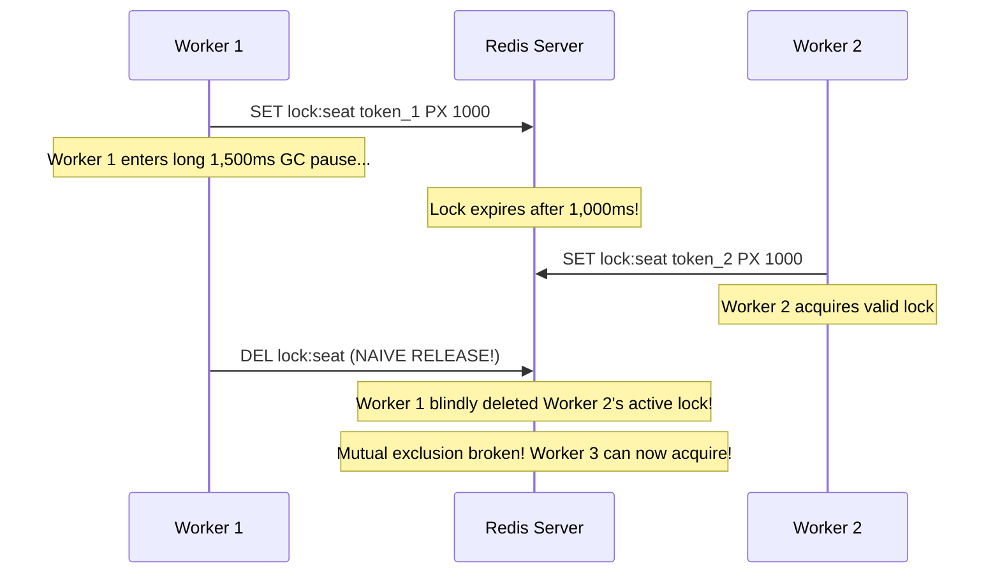
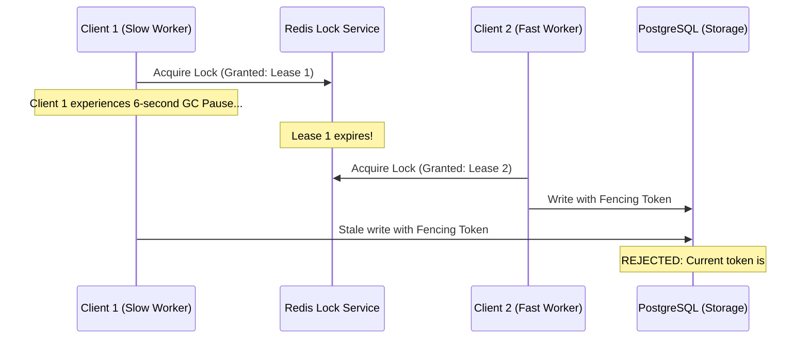

# SeatLock Lab: Failure Modes & Fault-Tolerance Matrix

**Project:** System Architecture Decoded — Executable Engineering Monograph  
**Module:** Distributed Systems Failure Analysis & Mitigation Protocols  

---

## 1. Production Failure Matrix

| Failure Scenario | Failure Symptom | Blast Radius | Root Cause | Architectural Mitigation in SeatLock Lab |
| :--- | :--- | :--- | :--- | :--- |
| **1. Redis Master Crash / Failover Key Loss** | Key lost before asynchronous replica write. | Low (Tier 1 ingress bypass). | Redis replication is asynchronous by default. | **PostgreSQL Row-Lock Invariant Guardian:** Postgres validates row state before granting the hold. No double-booking occurs. |
| **2. Worker Process GC Pause / Stall** | Lock TTL expires; worker awakens and writes. | High if unmitigated (Silent double booking). | Long GC pause exceeds 5,000ms Redis lock TTL. | **Monotonic Fencing Tokens:** Postgres verifies `show_seats.fencing_token`. If token was incremented, the stalled write is rejected. |
| **3. Redis Cluster Unreachable / Network Partition** | Ingress coordination unavailable. | Medium (Fallback mode activated). | Network partition, DNS failure, or Redis crash. | **Automatic Safe Fallback:** System falls back to `POSTGRES_FALLBACK` mode; logs degraded warning; operations continue safely. |
| **4. Blind Lock Key Deletion by Stale Owner** | Worker A deletes Worker B's active lock. | High (Lock safety invariant broken). | Worker A experiences latency; lock expires; Worker B acquires; Worker A deletes key. | **Atomic Lua CAS Release:** Uses Lua script comparing stored token with caller token before deletion (`GET == ARGV[1] then DEL`). |
| **5. Stale Client Confirmation Attempt** | User attempts to pay after 60-second hold expired. | Medium (Customer frustration if unhandled). | Client network disconnection or prolonged hesitation. | **Database Time Expiration Check:** Postgres checks `NOW() > hold_expires_at` inside `FOR UPDATE` transaction. Returns `409 HOLD_EXPIRED`. |
| **6. Unexpected DB Connection / Query Abort** | Network reset or statement timeout. | Isolated to single transaction. | PostgreSQL connection pool timeout. | **Explicit `ROLLBACK` in `finally`:** Database transaction is rolled back; seat state remains unchanged; Redis lock released via Lua CAS. |
| **7. Malicious or Erroneous Production Reset Call** | Accidental wipe of production reservations. | Critical (Data loss). | Unprotected administrative/debug endpoint. | **Environment Guard:** `POST /api/shows/:id/reset` checks `config.nodeEnv !== 'production'`. Returns `403 Forbidden` in production. |

---

## 2. In-Depth Failure Scenario Analyses

### 2.1 The Stale Worker Blind-Deletion Anomaly
When using distributed locks in Redis, naive implementations release locks via simple `DEL lock_key`. This introduces a severe concurrency bug:



#### SeatLock Lab Solution: Atomic Lua Compare-and-Delete
SeatLock Lab executes an atomic Lua script:
```lua
if redis.call("get", KEYS[1]) == ARGV[1] then
    return redis.call("del", KEYS[1])
else
    return 0
end
```
If Worker 1's lock expired and Worker 2 owns the key, `redis.call("get")` returns `token_2`. Because `token_2 != token_1`, the script returns `0` and **preserves Worker 2's lock intact**. Verified by Quality Gate 9 in the test suite.

---

### 2.2 The Martin Kleppmann Redlock / GC Pause Critique
In his classic paper *"How to do distributed locking"*, distributed systems researcher Martin Kleppmann demonstrated that no distributed lock algorithm (including Redlock) can guarantee safety across client pauses unless the shared storage verifies a **fencing token**.



#### SeatLock Lab Solution:
1. Every hold grant increments `show_seats.fencing_token`.
2. When confirmation occurs, PostgreSQL verifies `seat.fencing_token == hold.fencing_token`.
3. If a stale lease attempt arrives, the token mismatch triggers `409 FENCING_TOKEN_MISMATCH`.
